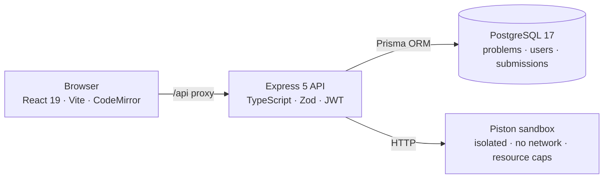

# 💖 algoholic

A distraction-free algorithm practice platform with a real sandboxed judge —
solve in JavaScript or TypeScript, reveal hints at your own pace, and unlock
the author's solution once you've cracked the problem yourself.

No leaderboards, no ads, no noise. Just problems.


## ✨ Features

- ⚖️ **a real judge** — submissions run in a sandboxed Linux environment (no network,
  CPU/memory/time caps) and get honest verdicts: accepted, wrong answer,
  time limit exceeded, runtime error, or compile error with line numbers
- 💡 **hints, not spoilers** — every problem ships 2–3 progressive hints, free for
  logged-in users and revealed one at a time, so you only get as much help as you ask for
- 🔓 **earned solutions** — the author's reference solution (with a "why this works"
  note and complexity analysis) unlocks *only after your own accepted submission*
- 📅 **problem of the day** · 🎲 **random unsolved pick** · 🧭 **try-next ladders**
  that guide you from one problem to its natural successors
- 📊 **personal stats** — progress by difficulty and category, acceptance rate,
  favorite language, full submission history with code viewer
- 🧩 **a curated problem set** — 35 classic problems, 399 tests, 12 categories —
  where every reference solution is itself verified by the platform's own judge
  before it ships (`npm run verify:solutions`)

## 🏗 Architecture



A TypeScript monorepo (npm workspaces): `client/` (React + Vite), `server/`
(Express + Prisma), `shared/` (types and constants used by both sides — one
source of truth, zero duplicated API contracts).

## ⚖️ The judge

Every submission travels the same pipeline:

1. **Validate & transpile** — Zod-validated input; esbuild transpiles TypeScript and
   syntax-checks JavaScript (errors become compile verdicts before any sandbox runs)
2. **Harness** — user code is wrapped in a runner that calls the exported function with
   each test case and reports one JSON result per test; stray `console.log` output is
   captured and shown back to the author
3. **Sandbox** — all tests execute in a single [Piston](https://github.com/engineer-man/piston)
   run: isolated Linux namespaces, networking disabled, per-problem time and memory caps
4. **Verdict** — results are compared server-side against expectations (canonical JSON,
   key-order-insensitive, floating-point tolerance); hidden test answers **never leave
   the server**

The judge is also its own quality gate: all 35 reference solutions are fed through it
programmatically, and any that isn't accepted fails the build story.

## 🧰 Tech stack

| Layer | Choice | Why |
|---|---|---|
| UI | React 19, Vite, CodeMirror 6, CSS modules | fast DX, zero UI-framework lock-in |
| API | Express 5, TypeScript, Zod | typed contracts end to end |
| Data | PostgreSQL 17, Prisma | typed queries, migrations, studio |
| Execution | Piston (Docker) | sandboxed untrusted code without building a jail |
| Sessions | httpOnly JWT cookies, bcrypt | no token handling in client JS |
| Quality | Vitest, oxlint | unit tests for the judge's comparison logic |

## 🚀 Getting started

Prerequisites: Node 20+, Docker.

```bash
npm install
cp server/.env.example server/.env    # set a real JWT_SECRET
npm run infra:up        # postgres + piston containers
npm run db:migrate      # apply migrations
npm run db:seed         # 35 problems · 399 tests (idempotent)
npm run judge:setup     # one-time: node runtime into piston + smoke test
npm run dev             # app on http://localhost:5173 (API proxied)
```

To share the app with other devices on your network: `npm run dev:lan`.

| Command | What it does |
|---|---|
| `npm run dev` / `npm run dev:lan` | Client + server (localhost / LAN-exposed) |
| `npm run build` · `npm run lint` · `npm test` | Build, oxlint, vitest |
| `npm run infra:up` / `infra:down` | Start / stop the docker stack |
| `npm run db:migrate` · `db:seed` · `db:studio` | Migrations, seed, Prisma Studio |
| `npm run judge:setup` | Install node into piston + smoke test |
| `npm run verify:solutions` | Re-judge all 35 reference solutions |

## 🧭 The app

| Page | What |
|---|---|
| `/problems` | browse & filter (category · difficulty · solved · search) |
| `/problems/:slug` | statement, samples, hints, try-next — plus the CodeMirror editor with Run / Submit (`Ctrl/Cmd+Enter`), local drafts, and verdict panel |
| `/daily` | problem of the day (same pick for everyone, changes at midnight) |
| `/stats` | progress by difficulty & category, acceptance rate, favorite language |
| `/submissions` | full history, each row opens the exact code you sent |
| `/profile` | username & 56 emoji avatars, edit identity, change password |

## 📮 API

| Endpoint | Description |
|---|---|
| `POST /api/auth/register` · `login` · `logout` | username + password, httpOnly JWT cookie |
| `GET/PATCH /api/auth/me` · `POST /api/auth/change-password` · `change-username` | account & credentials (password-verified changes) |
| `GET /api/problems` | list — filters: category, difficulty, solved status, search, paging |
| `GET /api/problems/:slug` | statement, samples, hints (logged-in), related problems, solved flag |
| `POST /api/problems/:slug/run` · `submit` | sample run · full judged submission |
| `GET /api/problems/:slug/solution` | author's solution — **403 until your own accepted submission** |
| `GET /api/submissions` · `/api/submissions/:id` | your history and code |
| `GET /api/stats` | personal progress aggregates |
